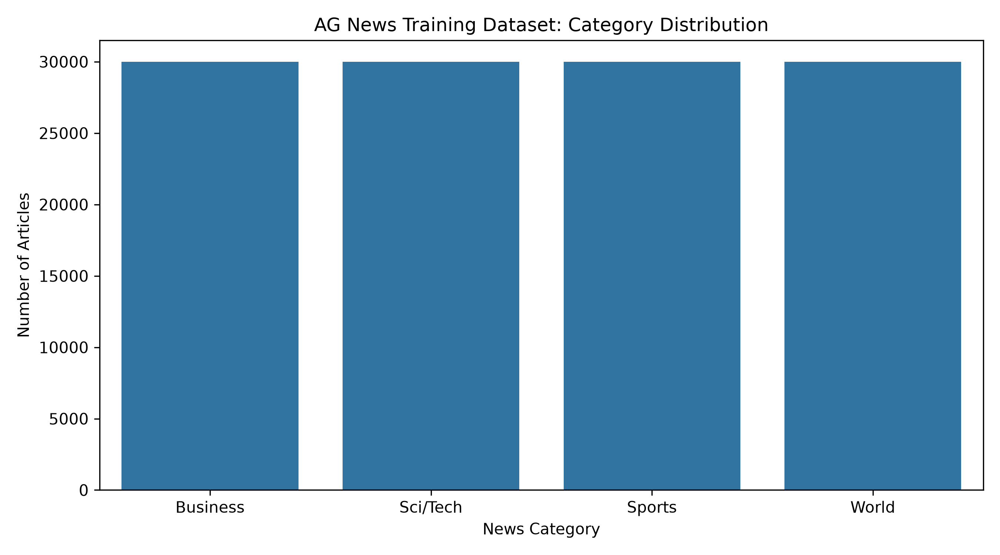
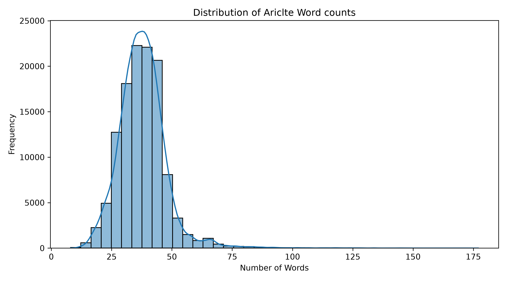
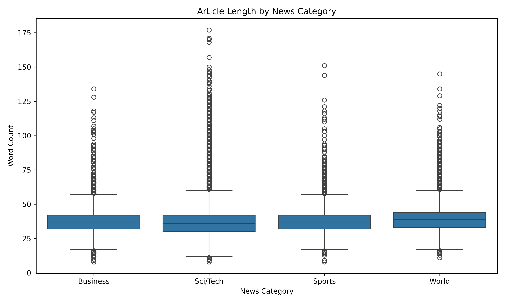
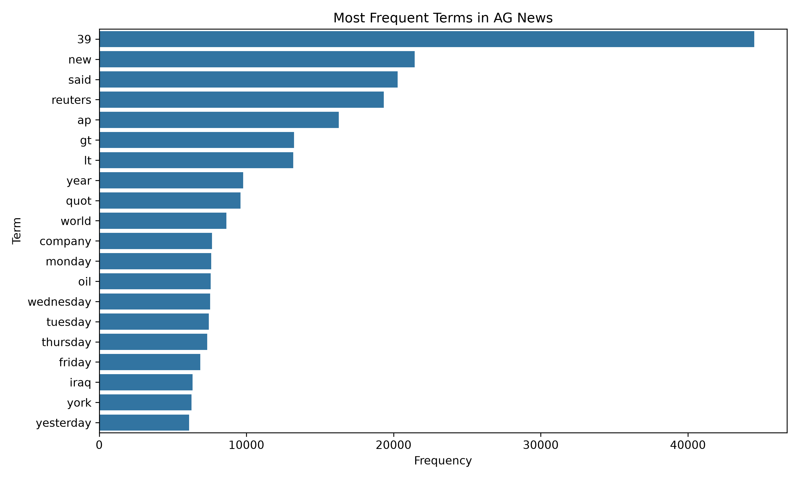

# Exploratory Data Analysis and Data Cleaning Report

## 1. Project Overview

This report documents the exploratory data analysis (EDA), data quality assessment and preprocessing activities conducted for the Contextual Intelligence project.

The objective of this phase was to understand the structure and characteristics of the AG News dataset, identify potential data quality issues, and prepare a reliable dataset for subsequent Natural Language Processing (NLP) and machine learning experiments.

The analysis focused on news category distribution, text characteristics, frequently occurring terms, duplicate records and label consistency.

## 2. Dataset Overview

The project uses the AG News dataset obtained from Hugging Face.

The dataset contains news headlines and short descriptions categorized into four broad topics:

- World
- Sports
- Business
- Sci/Tech

The original dataset consists of:

| Dataset split | Records |
|---|---:|
| Training | 120,000 |
| Testing | 7,600 |
| Total | 127,600 |

Each record contains text and a category label. Additional features, including word count and character count, were derived during data preparation.

**Dataset limitation:** The records contain news headlines and short descriptions rather than complete news articles. Consequently, the analysis and subsequent models operate on short-form news text.

## 3. Exploratory Data Analysis

### 3.1 News Category Distribution

**Figure 1: Distribution of training records across the four news categories.**

The training dataset contains exactly 30,000 records in each category:

| Category | Records |
|---|---:|
| World | 30,000 |
| Sports | 30,000 |
| Business | 30,000 |
| Sci/Tech | 30,000 |

The dataset has an evenly distributed class structure. This is useful for classification experiments because no category dominates the original training data.

A balanced distribution also makes accuracy more informative than it would be on a heavily imbalanced dataset. However, precision, recall and F1-score will still be evaluated for each category.

### 3.2 Text Length Distribution

**Figure 2: Distribution of word counts across the training dataset.**

The text length analysis produced the following descriptive statistics:

| Statistic | Word count |
|---|---:|
| Mean | 37.85 |
| Standard deviation | 10.09 |
| Minimum | 8 |
| 25th percentile | 32 |
| Median | 37 |
| 75th percentile | 43 |
| Maximum | 177 |

Most records contain approximately 25–50 words.

The distribution shows that the dataset primarily consists of relatively short news summaries, although some records are considerably longer.

These characteristics are relevant when selecting text representation techniques and configuring NLP models.

### 3.3 Text Length by News Category

**Figure 3: Comparison of word count distributions across news categories.**

The category-level comparison shows broadly similar typical text lengths across the four categories.

However, Sci/Tech exhibits a wider spread and some longer text outliers.

This suggests that text length alone is unlikely to provide sufficient information for distinguishing all four categories. Semantic and lexical features will therefore be important during model development.

Longer records were retained because their length alone does not indicate that they are invalid.

### 3.4 Most Frequently Occurring Terms

**Figure 4: Most frequently occurring terms in the training dataset.**

The frequent-term analysis highlights recurring vocabulary across the news records.

The initial analysis also identified HTML entity remnants, including encoded apostrophes and quotation-related characters. Examples included terms such as `quot`, as well as other text artifacts.

These observations motivated the implementation of HTML entity decoding and text normalization during preprocessing.

Frequent-term analysis is useful for understanding the vocabulary of the dataset, although highly frequent words are not necessarily the most useful features for classification.

## 4. Initial Data Quality Assessment

The initial inspection identified the following characteristics:

- No missing values in the original training dataset.
- Equal distribution across the four news categories.
- Repeated text records in the training dataset.
- Some identical text records assigned to different categories.
- One normalized text shared between the original training and testing datasets before the final cleaning process.
- HTML entity remnants and inconsistent text formatting.

The conflicting-label records required particular attention because identical text assigned to different categories can introduce ambiguity during supervised learning.

## 5. Data Cleaning Methodology

A reusable cleaning pipeline was implemented in Python.

The pipeline applies the following operations:

### 5.1 Text Normalization

The `clean_text()` function performs:

1. HTML entity decoding using Python's `html` module.
2. Whitespace normalization using regular expressions.
3. Conversion to lowercase.
4. Removal of leading and trailing whitespace.

These operations standardize text before duplicate and label-conflict detection.

### 5.2 Conflicting Label Removal

Training records were grouped by normalized text, and groups containing more than one distinct category label were identified.

All records belonging to these conflicting groups were removed from the training dataset.

This approach avoids arbitrarily assigning a single category to ambiguous records.

### 5.3 Duplicate Removal

Repeated training texts were removed using the normalized text column as the deduplication key.

Only one occurrence of each non-conflicting text was retained.

### 5.4 Train/Test Overlap Removal

Training records whose normalized text also appeared in the test dataset were removed from training.

This reduces the risk of duplicated examples influencing model evaluation.

The original test DataFrame is not modified by the cleaning function. A normalized copy is used for overlap detection, and the original test records are preserved in the processed data directory.

## 6. Data Cleaning Results

The cleaning pipeline produced the following results:

| Cleaning metric | Records |
|---|---:|
| Original training records | 120,000 |
| Conflicting text groups identified | 22 |
| Conflicting rows removed | 44 |
| Duplicate text rows removed | 129 |
| Train/test overlap rows removed | 10 |
| Final training records | 119,817 |
| Testing records | 7,600 |

The final training dataset contains 119,817 records after the removal of conflicting-label records, repeated texts and train/test overlap.

The test dataset retains all 7,600 original records.

## 7. Post-Cleaning Validation

Additional validation checks were performed to confirm that the cleaning operations achieved their intended results.

| Validation check | Remaining records |
|---|---:|
| Duplicate training texts | 0 |
| Conflicting-label text groups | 0 |
| Normalized train/test overlap | 0 |

All three validation checks passed.

The cleaning pipeline also includes automated unit tests to verify the text normalization and data cleaning functions.

## 8. Key Findings and Decisions

The EDA and cleaning activities produced several important findings:

1. **Balanced categories:** The original training dataset contains an equal number of records in each category, providing a suitable foundation for initial multiclass classification experiments.

2. **Short-form text:** Most records contain relatively short news summaries, making text vectorization and semantic representation important components of the modelling process.

3. **Text normalization:** HTML entity decoding, lowercase conversion and whitespace normalization revealed additional duplicate and conflicting records.

4. **Ambiguous labels:** Removing conflicting-label groups helps reduce ambiguity in the supervised training data.

5. **Duplicate control:** Removing repeated normalized texts prevents identical examples from being counted multiple times during training.

6. **Evaluation integrity:** Removing normalized text overlap between training and testing reduces the risk of direct text duplication across the two datasets.

## 9. Limitations

The analysis has several limitations:

- The AG News dataset contains headlines and short descriptions rather than full news articles.
- Its four broad categories do not capture every possible topic or contextual relationship.
- Conflicting-label records were excluded rather than independently relabelled.
- The dataset was originally collected for news classification, not contextual advertising or brand suitability assessment.
- Removing overlapping training records does not establish that all possible forms of semantic similarity between training and test records have been eliminated.

The dataset therefore provides a foundation for developing and evaluating NLP techniques, but additional simulated advertising data and suitability criteria will be required for the broader project objectives.

## 10. Next Steps

The next phase will establish a baseline news classification model using:

- TF-IDF for numerical text representation.
- Logistic Regression for multiclass classification.
- Stratified training and validation splitting.
- Accuracy, precision, recall and F1-score for performance evaluation.
- A confusion matrix to examine classification errors.

The baseline model will provide a reference point for subsequent experiments involving Sentence Transformers, semantic embeddings and contextual advertising matching.

The final test dataset will remain separate from model fitting and validation and will be used for final evaluation.
